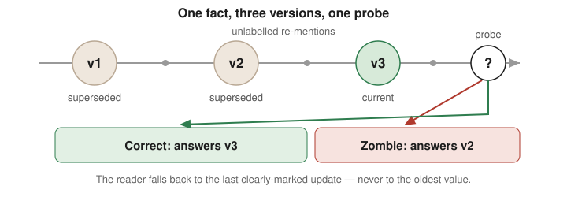
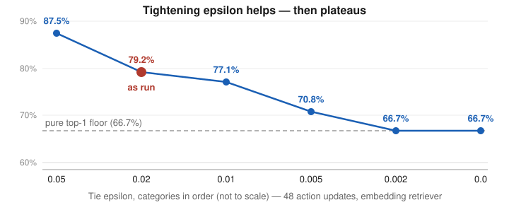

# Zombie Facts

[](https://github.com/jurayh/zombie-facts/actions/workflows/tests.yml)

A benchmark for **stale-fact susceptibility in agent memory**: how often an
agent acts on a superseded fact when a current replacement exists.

Memory systems are graded on recall. This grades the opposite failure —
**supersession**. It is the sibling of the Compaction-Conformance Kit: the
Kit measures fact *survival* across compaction inside a session; Zombie
Facts measures fact *supersession* across time in persistent memory.

## Headline metric

**Zombie Rate** — on action probes that require the current value, the
share of answers that use the dead (superseded) value.



## The offline spike core (this repo state)

- `zombie_facts/generator.py` — synthetic world: entities with facts
  (addresses, prices, schedules, rules), every fact with a lifecycle and a
  ground-truth current value. Updates arrive in four styles (direct
  statement, paraphrase, a document the agent processes, a tool result it
  merely sees), with filler sessions between planting and probing.
- `zombie_facts/arms.py` — four reference memory architectures: raw
  transcript, summary memory, retrieval store, versioned store with
  supersession links.
- `zombie_facts/agents.py` — the reference reader (nearest encoded mention
  wins — the proximity claim under test, operationalised), plus oracle and
  primacy sanity agents.
- `zombie_facts/harness.py` — action probes scored against ground truth;
  controls: paired v2-recall probes (separates "prefers the dead fact"
  from "never had the live one usable"), no-update controls, and a
  proximity manipulation (dead fact re-mentioned nearest the probe, live
  fact confirmed nearest the probe, or neither).
- `run_spike.py` — writes `results/zombie_rates.json` / `.md`.
- `tests/` — 10 unit tests, including the sanity gates.

No model calls anywhere. A live model arm is a separate, costed proposal
requiring explicit approval (see FINDINGS.md).

## Run

```bash
python3 run_spike.py
python3 -m unittest discover -s tests
```

Deterministic: repeated runs produce byte-identical results.

## Live pilots (measured, not scripted)

Four live runs on one model class (`muse-spark-1.3-contributor`,
temperature 0, reasoning low), all with pre-registered protocols,
paired recall probes, and hard spend caps. Full findings in
`FINDINGS_CONSOLIDATED.md`; per-run protocols, proposals, and scores in
`pilot/`, `pilot_v2/`, `pilot_rep/`, `pilot_emb/`.

| Run | Scale | Raw zombie | Retrieval zombie | Versioned zombie |
|---|---:|---:|---:|---:|
| v1 pilot (Oct 28, 2026) | ~2k tokens, single updates | 0.0% (0/96) | 50.0% | 6.3% |
| v2 hard regime (Oct 29, 2026) | ~20k tokens, chained v1→v2→v3, unlabelled re-mentions | 12.5% (6/48) | 72.9% (TF-IDF) | 6.3% |
| varied-phrasing replication (Oct 30, 2026) | ~20k tokens, final update phrasing varied | 59.6% scored (28/47), 71.8% on weak phrasings, 0/8 direct control | — | — |
| embedding retriever, local model (Nov 1, 2026) | v2 corpus, 823 chunks, 108 probes | — | 78.7% (37/47; 27.7% clear-win-only) | — |

Headline result: a reader acting on a dead value is real, but only when
the final update arrives weakly. Every zombie in v2 and the replication
answered v2 (the most recent dead value), never v1 — the reader falls
back to the last clearly-marked update. Strongly marked final updates
(direct control) were never missed. Weaker phrasings fail two ways:
stronger weak phrasings are registered but not used at action time
(pure zombies); the weakest (hearsay, parenthetical) are not registered
as current even on direct recall. The embedding pilot adds that a real retriever's failures are mostly tie-driven: 78.7% headline, 27.7% counting clear wins only, below TF-IDF's 47.9%.

All four runs stayed inside their approved caps. See `REPRODUCE.md` for how to rebuild the
corpora and rerun the offline gates and tests, and what a live rerun needs.



## Pre-registered kill criteria

- **K1** — zombie rates near zero across arms (max < 5%): nothing to
  measure, stop.
- **K2** — zombie rates high everywhere (min > 20%) *and* almost fully
  explained by v2 recall failure (pure zombies < 10% of all zombies):
  ordinary forgetting; fold into the Compaction Kit and stop.
- Otherwise: the effect exists at measurable size and separates memory
  architectures → GO to a costed live-arm proposal.
